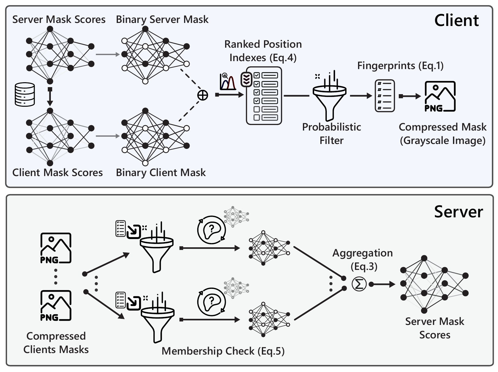

# DeltaMask

**DeltaMask: Minimizing Communication in Federated Fine-Tuning of Vision Foundation Models**

[ Paper](https://doi.org/10.1109/BigData62323.2024.10825398) · [ Project](https://nousphera.github.io/projects/deltamask/) · [ Code](https://github.com/Nousphera/DeltaMask) · [ Preprint](https://arxiv.org/abs/2311.17299) · [ Poster](https://nousphera.github.io/assets/posters/deltamask-a0-landscape.pdf) · [Citation](CITATION.cff)

Vasileios Tsouvalas · Yuki M. Asano · Aaqib Saeed

IEEE BigData 2024 · Published January 2025

<p align="center">
  <a href="https://nousphera.github.io/projects/deltamask/#overview"></a>
</p>

*DeltaMask's mask-update pipeline, from Figure 2 of the [accepted manuscript](https://pure.tue.nl/ws/portalfiles/portal/349909071/2024337517.pdf#page=4). Explore the [method and results](https://nousphera.github.io/projects/deltamask/#overview).*

## Abstract

Foundation Models (FMs) have revolutionized machine learning with their adaptability and high performance across tasks; yet, their integration into Federated Learning (FL) is challenging due to substantial communication overhead from their extensive parameterization. Current communication-efficient FL strategies, such as gradient compression, reduce bitrates to around 1 bit-per-parameter (bpp). However, these approaches fail to harness the characteristics of FMs, with their large number of parameters still posing a challenge to communication efficiency, even at these bitrate regimes. In this work, we present DeltaMask, a novel method that efficiently fine-tunes FMs in FL at an ultra-low bitrate, well below 1 bpp. DeltaMask employs stochastic masking to detect highly effective subnetworks within FMs and leverage stochasticity and sparsity in client masks to compress updates into a compact grayscale image using probabilistic filters, deviating from traditional weight training approaches. Our comprehensive evaluations across various datasets and architectures demonstrate DeltaMask efficiently achieves bitrates as low as 0.09 bpp, enhancing communication efficiency while maintaining FMs performance, as measured on 8 datasets and 5 pre-trained models of various network architectures.

## Installation

Python 3.12 and a C++17 compiler are tested. Package metadata permits Python 3.11–3.13; Linux/macOS are supported targets and native Windows is untested (use WSL2). Linux needs a compiler and Python development headers, for example `build-essential python3-dev`. macOS needs Python 3.12 and installed Command Line Tools. The real four-wise Binary Fuse extension builds from the bundled C++ source; no prebuilt Linux binary is redistributed.

Use a dedicated virtual environment whose **absolute path has no spaces**, required by Flower 1.40's migration/runtime path handling:

```bash
git clone https://github.com/Nousphera/DeltaMask.git
cd DeltaMask
bash scripts/setup.sh "$HOME/.venvs/deltamask"
source "$HOME/.venvs/deltamask/bin/activate"
python -m pytest -q
```

The setup script creates the venv, installs `requirements.txt` including Flower simulation and vision dependencies, and runs `pip check`. On macOS it selects the installed standalone Command Line Tools. Manual equivalent:

```bash
python3.12 -m venv "$HOME/.venvs/deltamask"
source "$HOME/.venvs/deltamask/bin/activate"
# macOS with standalone Command Line Tools:
# export DEVELOPER_DIR=/Library/Developer/CommandLineTools
python -m pip install -r requirements.txt
```

Installation and the smoke test download no datasets or model weights. Vision libraries are application dependencies so Flower's isolated runtime also installs them. After pulling changes, rerun installation to replace any older installed package.

## Data

Prepare official CIFAR data separately from model acquisition:

```bash
python scripts/prepare_data.py --dataset cifar10 --root data --download
python scripts/prepare_data.py --dataset cifar10 --root data --validate
```

The output is `data/cifar10/`, containing torchvision's original 50,000/10,000 train/test split and `manifest.json` with SHA256 hashes, class mapping and split sizes. Imports use `--source` instead of `--download`; existing dataset roots are protected. [DATASETS.md](DATASETS.md) documents every consumed layout and provider/access requirement.

| Dataset option | Acquisition and split |
|---|---|
| `cifar10`, `cifar100` | Official torchvision download; original train/test split |
| `svhn`, `fashion-mnist`, `emnist`, `food101` | Explicit torchvision download; EMNIST balanced variant |
| `eurosat`, `cars196`, `imagefolder` | Import acquired `train/CLASS/*` and `test/CLASS/*` folders with fixed splits |

## Training

The native app defaults to the paper's pretrained CLIP ViT-B/32 and prepared CIFAR-10 images. Prepare the dataset first; `allow-download=true` permits the initial pinned model download. Launch two local SuperNodes:

```bash
mkdir -p results
export FLWR_HOME="$HOME/.flwr-deltamask"
export FLWR_LOCAL_SUPERLINK_HTTP_API_PORT=39134
export FLWR_LOCAL_CONTROL_API_PORT=39136
flwr run . local \
  --federation-config 'num-supernodes=2 client-resources-num-cpus=1 client-resources-num-gpus=0.0 init-args-num-cpus=2' \
  --run-config "data-root=\"$PWD/data\" allow-download=true output=\"$PWD/results/clip-cifar10-check.json\"" --stream
```

`num-clients` and `num-supernodes` must agree. Use absolute data, checkpoint and output paths because Flower's installed bundle has its own working directory. CPU training of the full paper architectures is memory intensive; size the client and server resources accordingly. A state directory alone does not isolate listening ports.

For the full configured experiment, use `--run-config configs/clip-cifar10-iid.toml` (30 clients) or `configs/clip-cifar10-noniid.toml` (30 clients, 20% participation, Dirichlet α=0.1), after editing that TOML file to set absolute data/output paths and the available device. Flower accepts either one TOML file or inline key-value overrides, so do not combine those formats. Set `num-supernodes=30`; CPU/GPU allocations must match your machine. A GPU configuration needs an appropriate CUDA PyTorch build and explicit GPU client resources.

For an explicit offline execution check, use full DINOv2-Small initialized from scratch, two generated 224×224 training images, two test images and one mask-training round:

```bash
deltamask-train --config configs/smoke.toml --output results/offline.json
# Same check through native Flower (same federation resources as above):
flwr run . local \
  --run-config "dataset=\"synthetic-images\" model=\"dinov2-small\" pretrained=false num-rounds=1 output=\"$PWD/results/flower-smoke.json\"" \
  --federation-config 'num-supernodes=2 client-resources-num-cpus=1 init-args-num-cpus=2' --stream
deltamask-train --help
```

The handler runner uses an in-process transport. The smoke config explicitly sets `pretrained=false`; it does not measure pretrained accuracy or reproduce the paper benchmarks. Both entry points use the same app handlers. Supported pretrained backbones are CLIP ViT-B/32 and ViT-L/14, DINOv2 Base and Small, and ConvMixer-768/32. [DATASETS.md](DATASETS.md) explains cached/local checkpoints. Use absolute paths with native Flower because its installed bundle has its own working directory.

## Evaluation

Both training entry points evaluate the server model on the prepared test split after every round. Evaluation samples stochastic masks with a recorded round-specific seed. The JSON `rounds` list includes accuracy, loss, `payload_bytes` and `uplink_bpp_per_client`.

Inspect the final evaluation from the Flower CIFAR run above:

```bash
python - <<'PYTHON'
import json
from pathlib import Path
report = json.loads(Path("results/clip-cifar10-check.json").read_text())
print(json.dumps(report["rounds"][-1], indent=2))
PYTHON
```

Accuracy is a fraction in `[0, 1]`. Uplink bpp measures the encoded mask payload, including metadata and PNG, per participating client and masked parameter. Classifier setup and downlink bytes are reported separately; see [byte accounting](#outputs-and-byte-accounting).

### Saved outputs

The JSON report saves configuration, input-manifest hash, package versions, accuracy, update bytes, score downlink bytes, classifier setup traffic and a final-score digest. A sibling `.npz` contains mask scores and the probed classifier without pickle. Existing output/checkpoint paths are preserved; choose another name to rerun. Run data validation before experiments; training checks split and label identity while full file hashes are verified explicitly by preparation.

The native protocol sends four-wise BFuse8 fingerprints compressed as PNG, not client score arrays. Small fixtures have substantial protocol-header overhead. The protocol settings below define initialization, sampling and byte accounting. Payloads contain visible filter fingerprints and public sampling metadata.

## Pretrained models

Select a backbone with the Flower `model` configuration key. CLIP and DINOv2 use the pinned revisions in [model.py](src/deltamask/model.py); set `allow-download=true` to acquire weights, or supply a cache/local checkpoint as described in [DATASETS.md](DATASETS.md).

| Model option | Pretrained backbone |
|---|---|
| `clip-vit-b32` | OpenAI CLIP ViT-B/32 |
| `clip-vit-l14` | OpenAI CLIP ViT-L/14 |
| `dinov2-base` | DINOv2 Base |
| `dinov2-small` | DINOv2 Small |
| `convmixer-768-32` | timm `convmixer_768_32.in1k` |

Training saves the learned mask scores and classifier in `.npz`; the frozen backbone is loaded from its recorded model revision. `pretrained=false` constructs the selected full paper architecture with random weights, without downloading. Pretrained loading failures are surfaced; there is no replacement model or random-weight fallback. Local checkpoints must match the selected architecture.

## Method and protocol

| Stage | Code | Behavior |
|---|---|---|
| Classifier adaptation | `model.probe`, `server_app.run_server` | One local epoch per client, sample-weighted classifier averaging, frozen backbone |
| Stochastic masks | `model.Model.enable_masks`, `MaskedLayer` | Final five backbone blocks; Bernoulli forward with identity straight-through gradients in probability space |
| Shared reference | `codec.sample_mask` | NumPy PCG64, seed plus round, one flattened random stream |
| Changed-position selection | `codec.bernoulli_kl`, `selected_changes` | Full Bernoulli KL, floor(κ × changed positions), stable index ties |
| Four-wise BFuse8 | `native/fastfilter`, `_bfuse` | Four hash locations and eight-bit fingerprints; all inserted keys verified after construction |
| Payload | `codec.encode` / `decode` | PNG bytes, filter geometry, seed, dimension, version and context digest |
| Mask reconstruction | `server_app.run_server` | Query every coordinate and XOR matches with the shared reference |
| Bayesian aggregation | `aggregate.BayesianMask` | Unweighted binary observations, Beta(1,1) MAP and probability clipping |
| Flower application | `client_app`, `server_app` | Classifier arrays during setup; encoded bytes for mask updates |

Local and global transmission masks use common random uniforms within a round. Each mask is marginally Bernoulli; the coupling reduces changed positions. Each round uses a new public stream, while local minibatch sampling has a separate Torch client/round seed.

Mask logits initialize at zero, giving probability 0.5. Selected linear/convolution weights and biases, the CLIP projection and the classifier are masked; earlier blocks and normalization parameters remain frozen. The Bernoulli straight-through estimator passes the incoming gradient unchanged in probability space, and sigmoid supplies its derivative. Adam optimizes local scores.

The cosine selection schedule increases κ from 0.8 to 1.0 over `max(1, (R−1)//16)` rounds and stays at its endpoint. Bayesian priors reset before aggregation at rounds divisible by `floor(1/participation)`. Probabilities are clipped to `[1e−7, 1−1e−7]`. Evaluation samples seeded stochastic masks per forward batch.

Top-κ selection and filter false positives make mask reconstruction lossy; PNG compression is lossless. The payload carries visible filter fingerprints and public sampling metadata.


## Outputs and byte accounting

JSON reports configuration, the input-manifest hash, package versions, per-round accuracy and actual mask-payload bytes, including metadata and PNG. Uplink bits per parameter divide those bytes by the participating client count and masked parameter count. Separate counters record classifier-probe uplink and score/head downlink record sizes.

These are application-payload measurements: network framing, metrics/control messages, initial pretrained-checkpoint downloads and deployment setup are excluded. Short runs can have proportionally larger setup overhead.

The sibling `.npz` stores `scores`, `head.weight` and `head.bias` without pickle. To evaluate saved state, rebuild `make_model` with the JSON configuration and class count, load the head tensors, call `enable_masks()`, then `set_mask_scores(model, scores)`. Frozen pretrained weights are loaded from the recorded model revision. Optimizer state and automatic training resumption are not stored. Existing JSON or checkpoint files are protected from overwrite.


## Results

The accepted manuscript reports the following averages across eight image-classification datasets with CLIP ViT-B/32 and 30 clients. The IID setting uses Dirichlet α=10, full participation and 100 rounds; the non-IID setting uses α=0.1, 20% participation and 300 rounds. Both use one local epoch. Values are from [Tables II and III](https://pure.tue.nl/ws/portalfiles/portal/349909071/2024337517.pdf#page=11).

| Method | IID accuracy ↑ (%) | IID bitrate ↓ (bpp) | Non-IID accuracy ↑ (%) | Non-IID bitrate ↓ (bpp) |
|---|---:|---:|---:|---:|
| Fine-tuning | 88.08 | 32 | 83.19 | 32 |
| FedMask | 79.23 | 1.0 | 68.86 | 1.0 |
| EDEN | 84.14 | 0.691 | 78.56 | 0.715 |
| DeepReduce | 76.53 | 1.089 | 73.90 | 1.173 |
| FedPM | 86.07 | 0.872 | 81.64 | 0.948 |
| **DeltaMask** | **85.44** | **0.151** | **81.13** | **0.233** |

DeltaMask is within 0.63 percentage points of FedPM in the IID setting and 0.51 points in the non-IID setting, at the lower reported bitrates. The fine-tuning reference adapts the same last five backbone blocks targeted by masking. The settings use different round counts, so bpp alone is not total training communication. See the [project findings](https://nousphera.github.io/projects/deltamask/#findings) for per-backbone results and study details.

## Citation

```bibtex
@inproceedings{tsouvalas2025deltamask,
  title = {DeltaMask: Minimizing Communication in Federated Fine-Tuning of Vision Foundation Models},
  author = {Vasileios Tsouvalas and Yuki M. Asano and Aaqib Saeed},
  booktitle = {2024 IEEE International Conference on Big Data (BigData)},
  year = {2025},
  pages = {8042--8051},
  publisher = {IEEE},
  doi = {10.1109/BigData62323.2024.10825398},
  url = {https://doi.org/10.1109/BigData62323.2024.10825398}
}
```

## License and attribution

First-party code has no repository-wide license grant. FastFilter's Apache-2.0 terms, copyright and modification attribution are in [THIRD_PARTY_LICENSES](THIRD_PARTY_LICENSES). Paper figures, datasets and pretrained checkpoints retain their own terms.

Native C++ sources and required license text are included in a generated JSON bundle for Flower's text-only application packaging. After changing native sources, regenerate it with `python scripts/bundle_native.py`; `python -m pytest -q` verifies that the bundle matches the canonical files.
