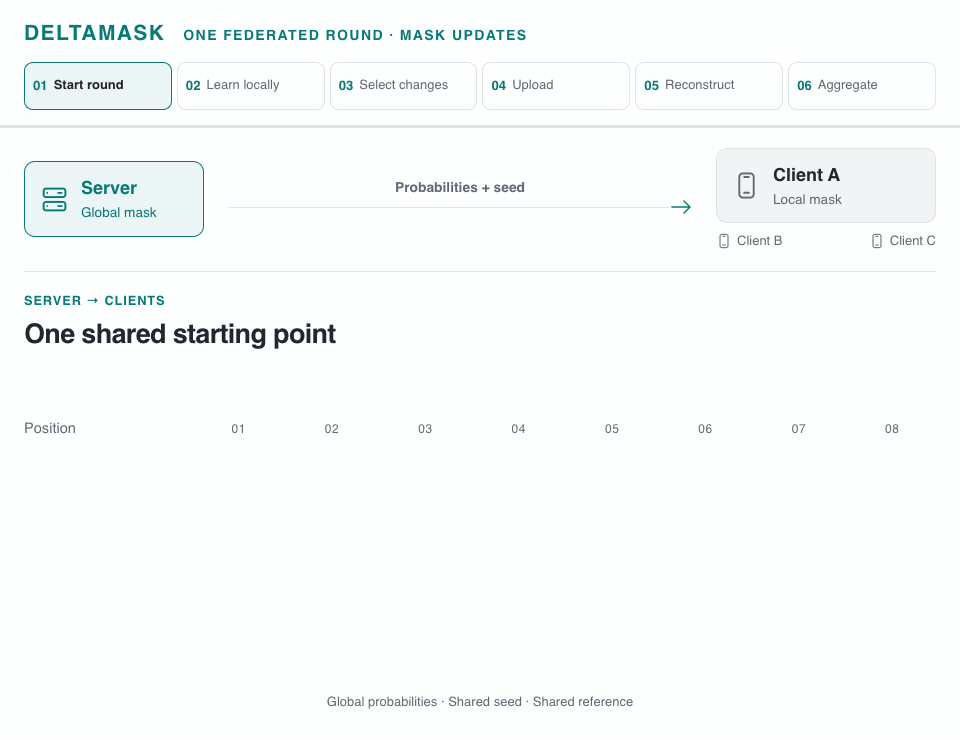

<h1 align="center">DeltaMask</h1>
<p align="center"><strong>Minimizing Communication in Federated Fine-Tuning<br>of Vision Foundation Models</strong></p>
<p align="center"><a href="https://vtsouval.github.io/"><strong>Vasileios Tsouvalas</strong></a> · Yuki M. Asano · Aaqib Saeed</p>

<p align="center">
  <a href="https://doi.org/10.1109/BigData62323.2024.10825398" title="Read the paper"></a>
  <picture></picture>
  <a href="https://nousphera.github.io/DeltaMask/" title="Explore the project"></a>
  <picture></picture>
  <a href="https://nousphera.github.io/assets/posters/deltamask-a0-landscape.pdf" title="View the poster"></a>
</p>

## Abstract

**DeltaMask** adapts vision foundation models in *Federated Learning (FL)* while keeping pretrained weights **frozen**. Clients learn *stochastic binary masks*, compare them with a shared reference, and retain the changes with the **highest information gain**. Four-wise *binary fuse filters* encode those positions into compact PNG uploads. The server *approximately reconstructs* the masks and updates their probabilities through **Bayesian aggregation**. Across eight datasets and five pretrained backbones, the paper reports communication as low as **0.09 bits per parameter**, with *competitive recognition accuracy*.

<p align="center">
  <a href="docs/assets/readme/method-light.mp4" title="Watch the method video">
    <picture>
      <source media="(max-width: 600px) and (prefers-color-scheme: dark)" srcset="docs/assets/readme/method-dark-mobile.gif">
      <source media="(max-width: 600px)" srcset="docs/assets/readme/method-light-mobile.gif">
      <source media="(prefers-color-scheme: dark)" srcset="docs/assets/readme/method-dark.gif">
      
    </picture>
  </a>
</p>

## Setup

Create and activate the `deltamask` environment:

```bash
git clone https://github.com/Nousphera/DeltaMask.git
cd DeltaMask
python3.12 -m venv --prompt deltamask "$HOME/.venvs/deltamask"
source "$HOME/.venvs/deltamask/bin/activate"
```

From the activated `deltamask` environment, install the requirements:

```bash
python -m pip install -r requirements.txt
```

> [!NOTE]
> The bundled four-wise filter builds with a C++17 compiler: Command Line Tools on macOS, or `build-essential python3-dev` on Ubuntu.

## Data and Weights

Download, prepare and validate the datasets:

```bash
# One dataset
python scripts/prepare_data.py --dataset cifar10

# All datasets
python scripts/prepare_data.py
```

**Datasets:** `cifar10` · `cifar100` · `svhn` · `fashion-mnist` · `emnist` · `food101` · `eurosat` · `cars196`.

For [Cars196](https://www.kaggle.com/datasets/jessicali9530/stanford-cars-dataset), download the images, [devkit](https://github.com/pytorch/vision/files/11644847/car_devkit.tgz) and [test labels](https://www.kaggle.com/code/subhangaupadhaya/pytorch-stanfordcars-classification/input) into `raw/cars196/stanford_cars/` before preparation:

```text
stanford_cars/
├── cars_train/
├── cars_test/
├── cars_test_annos_withlabels.mat
└── devkit/
    ├── cars_train_annos.mat
    └── cars_meta.mat
```

> [!NOTE]
> EuroSAT uses an 80/20 split with seed 42. EMNIST defaults to `letters`; select `--emnist-split balanced` for the balanced variant.

### Prepare Model

```bash
python scripts/prepare_model.py
```

**Backbones:** `clip-vit-b32` (default) · `clip-vit-l14` · `dinov2-base` · `dinov2-small` · `convmixer-768-32`. Select one with `--model`, or use `--model all`.

## Run Experiments

From the repository root, launch your chosen method as a **Flower App**:

```bash
# Shared experiment settings
common=(--dataset cifar10 --model clip-vit-b32 --setting iid --device cuda)

# DeltaMask (ours)
python scripts/run_experiment.py "${common[@]}" --method deltamask

# Fine-tuning · FedAvg
python scripts/run_experiment.py "${common[@]}" --method finetune

# Linear probing · frozen backbone
python scripts/run_experiment.py "${common[@]}" --method linear-probe

# FedPM · stochastic masks, packed-bit transport
python scripts/run_experiment.py "${common[@]}" --method fedpm

# FedMask · threshold-training variant
python scripts/run_experiment.py "${common[@]}" --method fedmask
```

| Setting | Clients | Rounds | Participation | Dirichlet α |
| :--- | ---: | ---: | ---: | ---: |
| `iid` | 30 | 100 | 100% | 10 |
| `noniid` | 30 | 300 | 20% | 0.1 |

Use `--setting noniid` for heterogeneous clients, `--seed` for repeated runs, or `--device cpu` / `--device mps` for local execution. All methods share a one-round classifier warm-up; the mask methods adapt the final five blocks, projection and classifier.

> [!NOTE]
> Metrics and learned weights are saved to `results/<method>-<model>-<dataset>-<setting>-seed<seed>.{json,npz}`. FedPM uses lossless packed bits; FedMask follows the paper experiment's threshold-training variant with stochastic Bayesian aggregation.

Re-evaluate a saved run:

```bash
python -m deltamask.evaluate results/deltamask-clip-vit-b32-cifar10-iid-seed42.json
```

## Citation

```bibtex
@inproceedings{tsouvalas2025deltamask,
  title = {DeltaMask: Minimizing Communication in Federated Fine-Tuning of Vision Foundation Models},
  author = {Vasileios Tsouvalas and Yuki M. Asano and Aaqib Saeed},
  booktitle = {2024 IEEE International Conference on Big Data (BigData)},
  year = {2025},
  pages = {8042--8051},
  publisher = {IEEE},
  doi = {10.1109/BigData62323.2024.10825398},
  url = {https://doi.org/10.1109/BigData62323.2024.10825398}
}
```

[MIT License](LICENSE) · [Third-party licenses](THIRD_PARTY_LICENSES)
